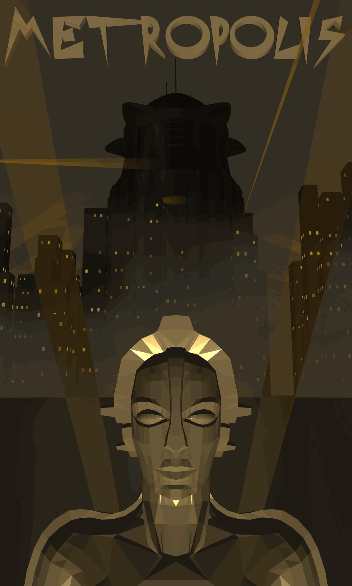
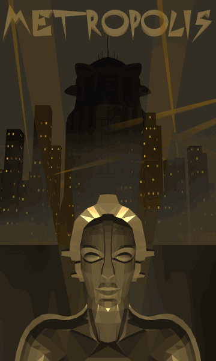
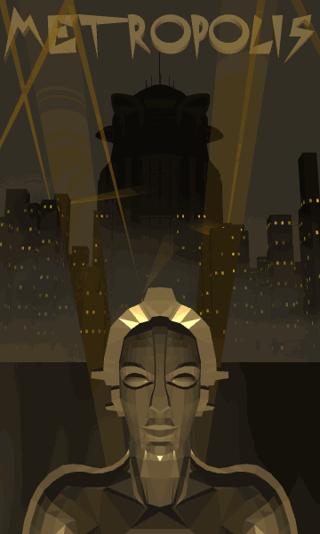

# Metropolis 2026

Eine interaktive 3D-Szene in [p5.js](https://p5js.org/) (WebGL), inspiriert von Fritz Langs *Metropolis* (1927):
die Maria-Figur auf einer Plattform vor einer dunklen Stadt mit Hochhäusern, Scheinwerfern, ziehendem Nebel und Blitzen.

**▶ [Live-Demo im Browser öffnen](https://lukasreckwald.github.io/metropolis_2026/)**

<table>
  <tr>
    <td width="260"></td>
    <td>
      <b>Die Szene</b> 
      Maria steht im Vordergrund, dahinter die Stadt mit dem Metropolis-Turm.
      Scheinwerfer streifen über die Gebäude, Nebel zieht durch die Straßen und Blitze erhellen kurz die Szene.
    </td>
  </tr>
  <tr>
    <td width="260"></td>
    <td>
      <b>Lichtringe</b> 
      Mit <code>L</code> erscheinen leuchtende Ringe, die um Maria auf- und abschweben.
    </td>
  </tr>
  <tr>
    <td width="260"></td>
    <td>
      <b>Freie Kamera</b> 
      Mit <code>F</code> löst sich der Schriftzug von der Kamera. Danach lässt sich die Kamera mit der Maus frei drehen und zoomen, um die Stadt aus allen Blickwinkeln zu erkunden.
    </td>
  </tr>
</table>

## Inspiration
Als Inspiration für dieses Projekt diente der Film "Metropolis" von Fritz Lang aus dem Jahr 1927. Der Film spielt in einer futuristischen Stadt, die von einer strengen sozialen Hierarchie geprägt ist. Hierbei lag der Fokus auf den hier gezeigten Postern, die die düstere und industrielle Atmosphäre der Stadt vermitteln.

Das Ziel des Projekts war es, eine ähnliche Atmosphäre zu schaffen. Insgesamt wollte ich eine visuelle Darstellung schaffen, die die düstere und faszinierende Welt von "Metropolis" einfängt, umgesetzt mit p5.js.

## Steuerung
| Eingabe | Aktion |
|---|---|
| Maus ziehen / Scrollen | Kamera drehen / zoomen |
| `F` | Freie Kamera ein/aus (Schriftzug löst sich von der Kamera) |
| `L` | Animierte Ringe um Maria ein/aus |
| `T` | Blitze ein/aus |

## Technik
- **Scheinwerfer mit Raycasting:** Jeder Lichtkegel schickt einen Strahl in seine Richtung und prüft gegen die Bounding-Boxen der Gebäude und der Metropolis-Statue, wo er zuerst auftrifft. Dort endet der Kegel, statt durch die Häuser hindurchzuleuchten.
- **Gebackene Geometrie:** Die rund 200 Hochhäuser mit ihren Fenstern werden beim Start einmalig mit `buildGeometry()` zu zwei Modellen zusammengefasst. So braucht es pro Frame nur zwei Zeichenaufrufe statt mehrerer tausend.
- **Nahtloser Nebel:** Die Nebeltextur wird horizontal gespiegelt an sich selbst gehängt, sodass die rotierenden Nebelzylinder keine sichtbare Kante haben.
- **Zeitbasierte Animation:** Scheinwerfer, Blitze, Nebel und Ringe bewegen sich abhängig von der vergangenen Zeit, nicht von der Framerate, und laufen dadurch auf jedem Rechner gleich schnell.

## Aufbau
| Datei | Inhalt |
|---|---|
| `sketch.js` | Setup, Szenen-Konfiguration, Draw-Loop, Raycasting für die Scheinwerfer |
| `building.js` | Hochhäuser mit Fenstern (werden einmalig zu einer Geometrie gebacken) |
| `spotlight.js` | Scheinwerferkegel, die an Gebäuden/der Statue enden |
| `fogLayer.js` | Rotierende Nebelschichten |
| `thunderStrike.js` | Blitze mit Verzweigungen und Aufhellung |
| `mariaStatue.js`, `metropolisStatue.js` | Die beiden 3D-Modelle |
| `mariaPlatform.js`, `connectionRing.js`, `cityRing.js` | Boden der Szene |
| `animatedRing.js` | Leuchtende Ringe um Maria |

## Quellen

- **Metropolis-Gebäude:** [„Metropolis — Cityscape“](https://sketchfab.com/3d-models/metropolis-cityscape-d1d969f4c07c436bb541ba77bc3ff6fa) von *janitor* auf Sketchfab, lizenziert unter [CC BY 4.0](https://creativecommons.org/licenses/by/4.0/)
- **Maria/Roboter-Figur:** [Thingiverse – thing:312041](https://www.thingiverse.com/thing:312041)
- **Schriftart:** [„Metropolis“](https://www.dafont.com/metropolis.font) von Alphabet&Type, auf dafont als „100% Free“ angegeben
- **Nebel-Textur:** [White Fog Smoke Effect](https://de.pngtree.com/freepng/white-fog-smoke-effect_9095056.html) von Pngtree.com
- **Filmplakat:** Library of Congress
- **Bibliothek:** [p5.js](https://p5js.org/)
